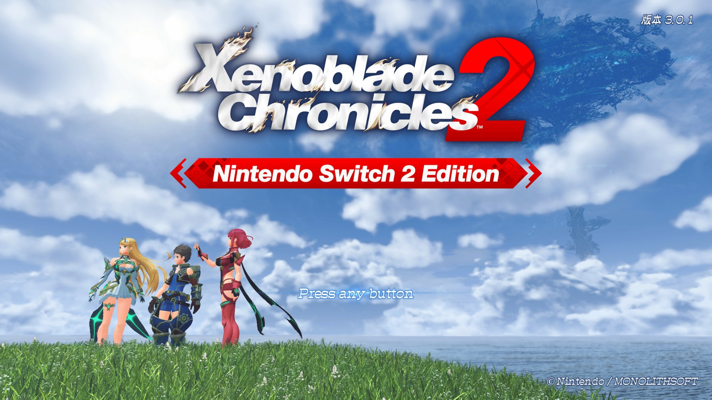
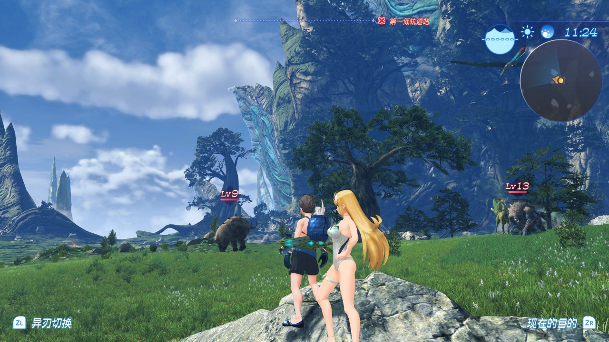

# Retail 3.0.1 Runtime Telemetry & Benchmark Record

Public benchmark and telemetry extract from local hardware verification runs (without game data).

## Test Configuration

| Item | Observed Value |
|---|---|
| **Host OS / API** | Windows x86-64 · Vulkan 1.4.315 (`VK_EXT_external_memory_host`, `VK_EXT_memory_budget`) · SDL 3.4.18 |
| **GPU / Driver** | AMD Radeon RX 6800 XT (16.0 GiB VRAM, Adrenalin driver `0x00800161`) |
| **CPU** | AMD Ryzen 7 5800X (see [COMPATIBILITY.md](../COMPATIBILITY.md)) |
| **Program** | *Xenoblade Chronicles 2 – Nintendo Switch 2 Edition* Retail 3.0.1 (7 lifted NSO modules, `48,972` functions in `main`) |
| **Swapchain / HDR** | `2560×1440` · 4 images · format 64 · HDR10 (`peak 500 nits`, SDR white `240 nits`) · `fifo` |
| **Shader Cache** | `21,193` SPIR-V records (`9,750` preloaded via `spirv.preload.pack`, `72 MiB` read on 6 threads) |

## Representative Measurements

| Scenario / Route | Output / Upscaler | Measured Frame Rate | Notes |
|---|---|---:|---|
| **Title screen & steady scenes** (2026-11-23 interactive run) | `2560×1440` HDR10 · FSR 3.1.6 (`FidelityFX`) | **60.0 fps** | `present pass GPU 0.118–0.133 ms avg` once pipelines warm (`t = 7 s … 63 s`) |
| **Ports & typical areas** | `2560×1440` · TAAU / FSR 4.1.2 / FSR 3.1.6 | **59–60 fps** (`59.7`, 1% low `50.8–51.3`) | See [COMPATIBILITY.md](../COMPATIBILITY.md) & [STATUS.md](../../STATUS.md) |
| **Open plain (heaviest scene)** | `2560×1440` (~`4,400 draws/frame`) | **43–52 fps** | CPU replay `~9.0 ms`, GPU `~7.3 ms`, total frame time `18–23 ms` (see [ARCHITECTURE.md](../ARCHITECTURE.md)) |

## Telemetry Excerpt (2026-11-23 60 Hz HDR10 Live Session)

Sanitized excerpt from `work/logs/play-20261123-152002.log`:

```text
[  0.436841 I] gfx: GPU 0: AMD Radeon RX 6800 XT (discrete, Vulkan 1.4.315, driver 0x00800161, 16.0 GiB)
[  0.459035 I] gfx: HDR: mode 1, scene HDR, wanted output hdr10, paper white 240 nits, peak 500 nits, peak ratio 2.08
[  0.575513 I] gfx: swapchain 2560x1440, 4 images, format 64, color space 1000104008 (hdr10), present mode fifo
[  0.737745 I] nvn: shader pack: preload.pack has 9750 shaders (292 MiB of SPIR-V in 72 MiB)
[  2.638298 I] nvn: present interval 1: the game's frame rate is 60.00 fps
[  4.318938 I] fsr3: context made: FSR 3.1.6, 1920x1080 -> 1920x1080, inverted depth, hdr 1, auto exposure 1
[ 44.433638 I] gfx: fps 60.0, present pass GPU 0.126 ms avg
[ 63.577993 I] gfx: fps 60.0, present pass GPU 0.128 ms avg
```

## Captured Visual Verification

*(Note: checked-in `.jpg` assets below are compressed preview captures without an in-frame F10 OSD overlay; exact swapchain resolution and `60.0 fps` pacing are confirmed in the telemetry excerpt above.)*

| Title Screen (`1920×1080` preview · `TitleLogoSwap` mod active) | Gormott Field (`1280×720` preview · Clear Save · Retail `3.0.1`) |
|---|---|
|  |  |
